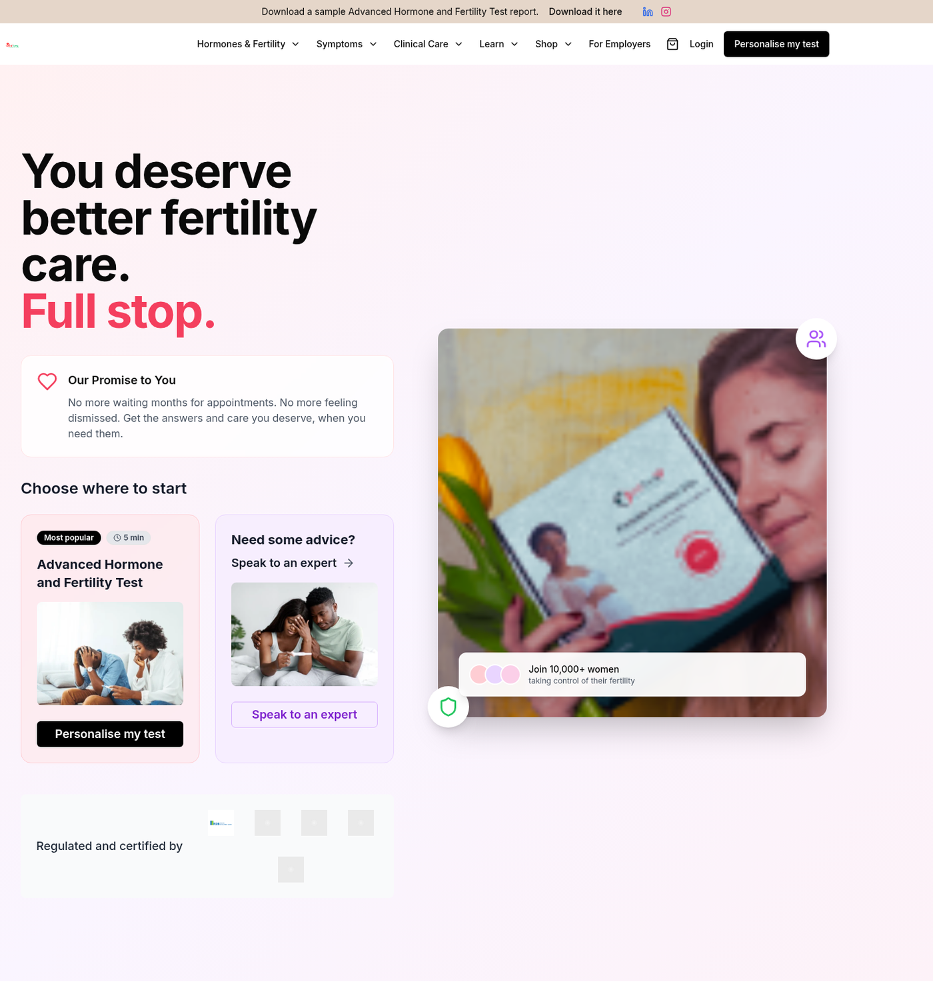

# FertiTerra

A fertility care platform for Africa: education, at home testing, guided cycle tracking and access to clinicians. Built for the couples who are usually left out of the conversation.



Demo walkthrough available on request.

## Why this exists

Fertility care in Africa is expensive, urban, and quiet. Couples are told to keep trying, testing is far away and costly, and no one tracks anything. FertiTerra brings the first steps of fertility care into a phone: understand your cycle, test at home, talk to a clinician, and know what to do next.

## What is inside

- *Fertility tracking*: cycle logging, fertile window prediction and trends over time
- *At home test kits*: shop and checkout for kits, with order tracking
- *Consultations*: appointment booking and a video consultation path
- *Plans*: tiered care plans with what each one includes
- *Knowledge centre and blog*: fertility education written for the local context
- *Community*: peer space for questions people do not want to ask out loud
- *Employer offer*: fertility benefit page aimed at companies covering staff
- *Provider side*: admin console for consultations, orders and content
- *Supporting services*: email service, video call service, telemedicine integrations

## Stack

Next.js 14 (App Router), React 18.3, TypeScript, Tailwind CSS, Radix UI primitives, Supabase clients for data and auth, server actions, deployed on Vercel

## Running it

Authentication runs on Supabase Auth with cookie based sessions: server actions sign users in and out, middleware refreshes the session on each request, and the admin console checks the `profiles` role server side. Data access goes through the Supabase clients in `lib/`. Create a Supabase project, run `supabase/profiles.sql` once to provision the profile table, then set the environment variables below.

```
cp .env.example .env.local
npm install
npm run dev
```

## Structure

`app/` routes (marketplace, plans, consultations, appointments, dashboard, admin, auth, knowledge centre)
`components/` UI and product sections, with a typed primitive set in `components/ui`
`lib/` Supabase clients, email service, video call and telemedicine integration, utilities, validation
`actions/` server actions for auth, fertility tracking and user management

## Status

Working build with the core patient journey in place end to end. Next: clinician onboarding, payment rails for plans, and mobile packaging.

## Author

Chijioke Ugorji Kalu, founder, FertiTerra Technologies, Kigali

---

*Proprietary. Copyright (c) 2026 Chijioke Ugorji Kalu. All rights reserved. Shared for review only.*
